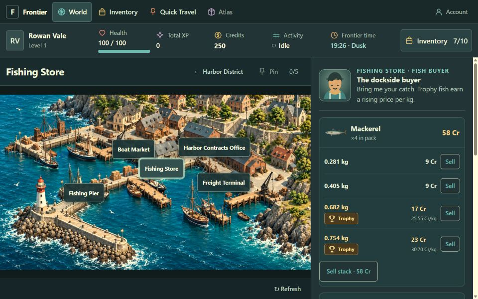
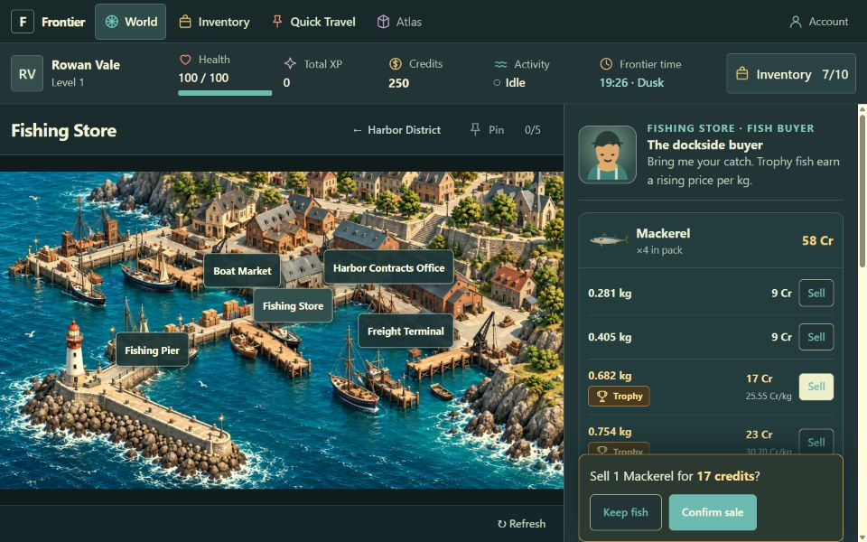
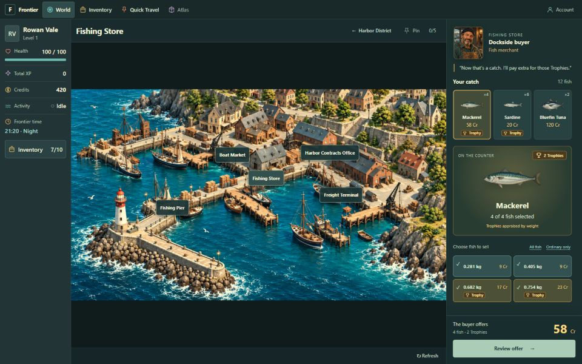
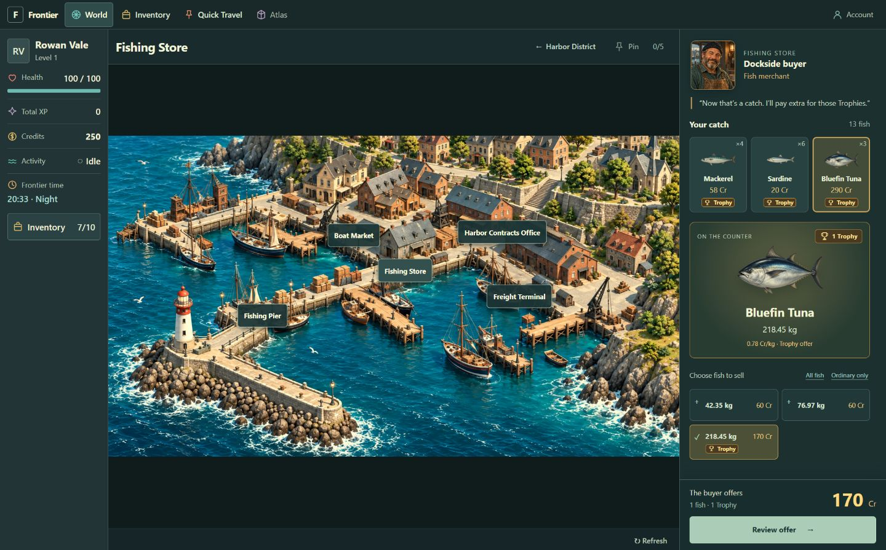
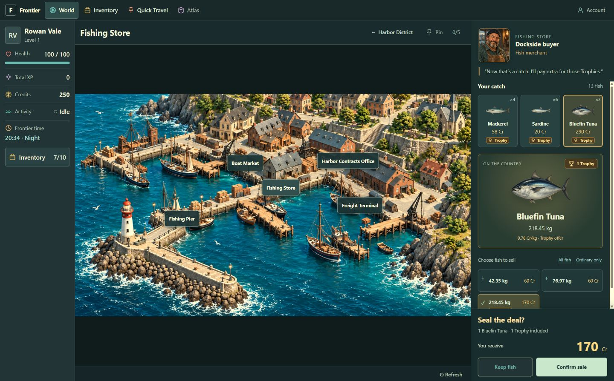
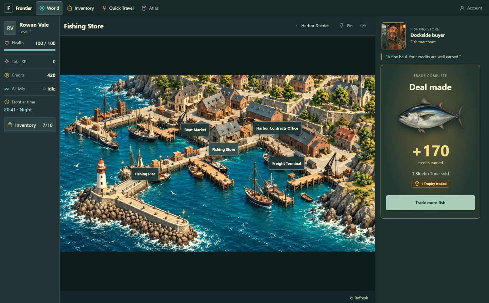

# A01 — Fishing Store buyer review

Reviewed 2026-09-25. Scope: the existing buyer's presentation and interaction. A01 remains
`READY_FOR_SOL_PASS_TEST`; owner visual approval and final A01 acceptance are pending.
Pricing, server authority, inventory rules, schema, and sale API are unchanged.

## Starting findings

The original panel was functional but presented every fish as a repeated price row. The merchant
had little presence, Trophy appraisal competed with ordinary rows, and repeated Sell buttons made
the next action less distinct. Confirmation appeared among the long list without moving focus.
These were engagement, hierarchy, and keyboard-orientation problems in this specific flow.

## Revised journey

1. **Meet the buyer and choose a stack — clear.** A portrait and short contextual dialogue establish
   the merchant. Compact cards show species, quantity, quoted stack value, and Trophy status. The
   first stack opens immediately; selecting another replaces the single appraisal.
2. **Appraise the catch — clear.** Fish artwork anchors the view. Selectable specimens show exact
   weight and server-quoted value. Trophy fish receive a warm treatment; an individually selected
   Trophy shows its quoted credits/kg. All fish and Ordinary only support quick selection without
   obscuring the fish being sold.
3. **Review and confirm — clear.** The offer footer remains separate from scrolling content. The
   confirmation states quantity, Trophy count, and price inside the activity panel. Keep fish or
   Escape cancels and returns focus to Review offer.
4. **Receive payment and continue — clear.** A Deal made receipt shows the actual credits earned and
   fish sold. Trade more fish returns to the remaining catch. An ambiguous request failure retains
   its original sale intent and key for retry; the player cannot accidentally submit a new trade.

## Verification and health

The reviewed flow is functionally complete and visually coherent at the checked sizes. A separate
local database and review account were used; the player's existing inventory was not used for sales.
The live browser journey sold one 218.45 kg Trophy Bluefin Tuna for the quoted 170 Cr, updated the HUD
from 250 to 420 Cr, showed the receipt, and returned to the remaining 12 fish. Ordinary only selected
the two ordinary Mackerel and excluded both Trophies. Keyboard confirmation and Escape cancellation
were checked, including narrow layouts.

| CSS viewport | Result                                                                  | Evidence                                                               |
| ------------ | ----------------------------------------------------------------------- | ---------------------------------------------------------------------- |
| 1440×900     | Complete appraisal; offer stays visible                                 | [Appraisal](03-appraise-1440x900.png)                                  |
| 1366×768     | No horizontal overflow; footer within panel                             | [View](appraise-1366x768.png)                                          |
| 1920×1080    | Complete world and buyer layout                                         | [View](appraise-1920x1080.png)                                         |
| 1280×720     | Compact layout; reachable offer footer                                  | [View](appraise-1280x720.png)                                          |
| 390×844      | Narrow layout; page and catch list scroll; confirmation reachable       | [Appraisal](appraise-390x844.png), [confirmation](confirm-390x844.png) |
| 320×640      | No horizontal overflow; both confirmation actions reachable by keyboard | [Confirmation](confirm-320x640.png)                                    |

Viewport dimensions were checked from the DOM. Screenshot exports may be scaled by the Windows
display/browser capture path. The original screenshots used a 960×600 CSS viewport. Captured images
were visually inspected; they are evidence of this review, not owner approval.

`npm run check` passed: formatting, lint, typecheck, **174 tests across 16 files**, and production
build. Nine buyer UI tests cover stack replacement, specimen selection, confirmation/cancellation,
focus, confirmed payload, receipt, retry key reuse, stale quote refresh, loading errors, and a lost
sale response followed by an empty quote refresh. Existing server pricing and atomic-sale tests pass.
The build retains its bundle-size advisory. This review is not a full screen-reader or WCAG audit,
and it does not replace the full A01 MVP acceptance run.

## Reviewed revision

This workspace has no committed baseline. SHA-256 fingerprints identify the reviewed implementation:

| File                                    | SHA-256                                                            |
| --------------------------------------- | ------------------------------------------------------------------ |
| `src/components/FishBuyerPanel.tsx`     | `467C0E22CE93BD2611443982664E3E99257229FA62776FCF8B3A974423481C65` |
| `src/fish-buyer.css`                    | `851621534B8F2345BE0B316E88B391C5F3BD075CE4E57CBFDA8A466DBAC1A569` |
| `public/assets/npcs/dockside-buyer.png` | `19E7C077F7EB76D6183E2641C39DAD78F8612339480CF4EF597E82BBA7B548FF` |

## Portrait asset

Generated with the built-in Image Gen tool and saved as
[`public/assets/npcs/dockside-buyer.png`](../../public/assets/npcs/dockside-buyer.png).
The server now serves PNG files with their correct MIME type. No dependency was added.

Generation prompt:

> Use case: stylized-concept. Create a single square NPC portrait asset for Frontier, a grounded
> browser sandbox game set in a working coastal harbor. A friendly seasoned fish buyer, middle-aged
> man with salt-and-pepper beard, weathered face, dark navy fisherman's knit cap, worn teal work shirt
> and brown canvas apron. Bust portrait facing slightly toward viewer, warmly appraising a catch
> off-camera. Painterly semi-realistic game illustration with detailed natural materials, matching
> illustrated coastal town assets. Composition: face large and readable in a small 80px square
> portrait, head and shoulders centrally framed with generous safe margin. Muted deep blue-green
> background with very subtle blurred wooden fish-shop interior, warm amber side lighting.
> Restrained, grounded, welcoming; no cartoon outlines or exaggerated fantasy armor. No fish in
> foreground, no words, lettering, logos, frames, icons, or watermark. Square image.
