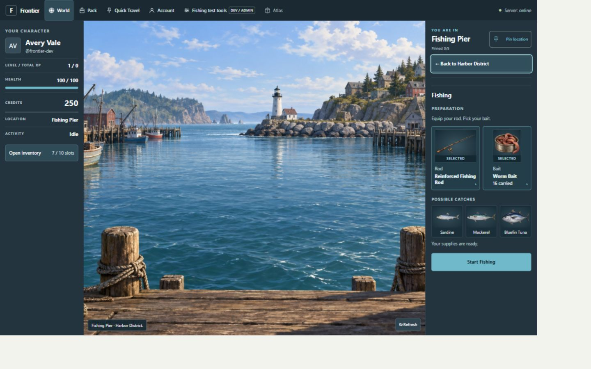
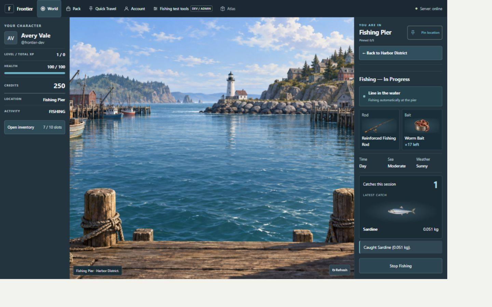
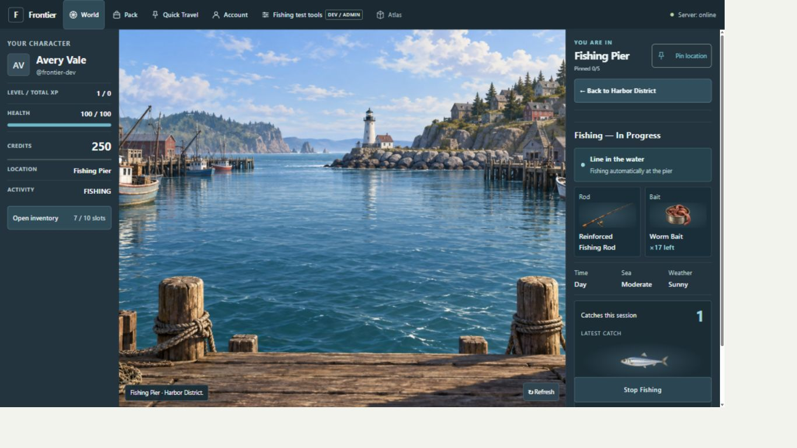
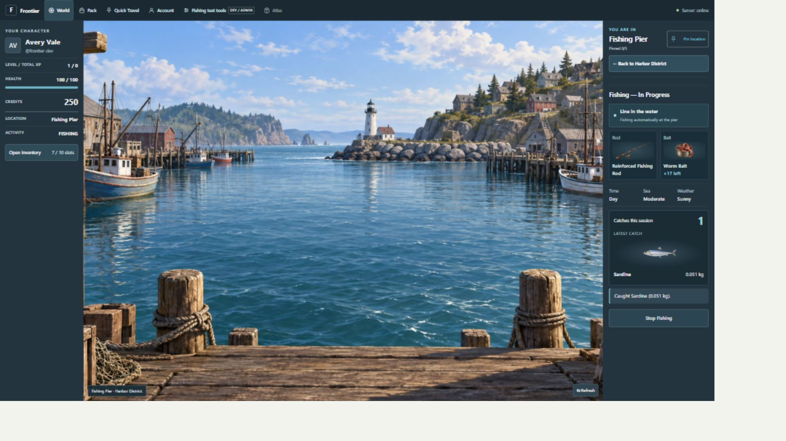
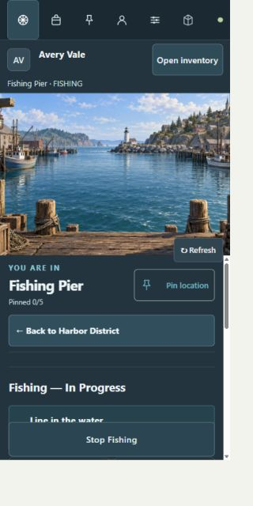
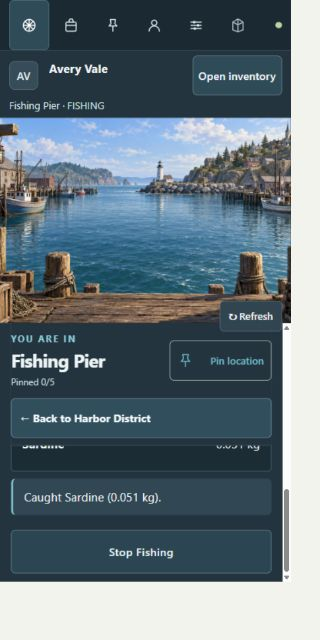
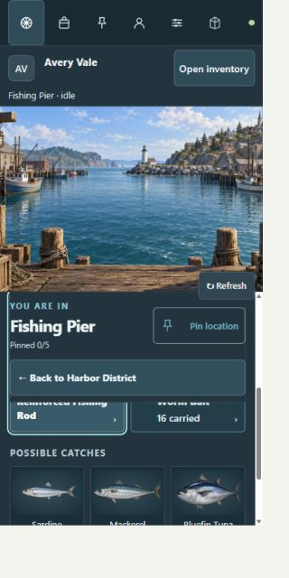

# A01 game-feel refinement — 2026-09-23

Owner visual approval: **PENDING**. Stage: **READY_FOR_SOL_PASS_TEST**.

This revision replaces the Fishing presentation in the previous review gallery. The supplied scene
and item assets are unchanged. Dimensions below were checked from the live DOM in CSS pixels;
the browser capture includes its scaling margins.

1. Preparation: illustrated Rod/Bait slots, explicit selection labels, and static Possible Catches.
   Carried-item selection and Escape focus return passed. Previous session feedback clears for setup.
2. Active: equipment artwork, real remaining bait and conditions, active-session indicator, catch
   count, illustrated latest catch and its weight. Start and authorized forced catch passed.
3. Narrow active: internal scrolling and sticky Stop keep the activity operable with location/Back
   retained. Explicit stop passed; the review character was left idle in Preparation.

The indicator is decorative session activity, not a countdown. Reduced motion disables its animation.
Existing automated tests cover loading, missing/stale supplies, failures, focus and server commitment.
All four checked viewport sizes had document dimensions equal to the viewport. Owner appearance
approval is separate from these checks.

## Preparation — 1440×900

## Active — 1440×900

## Active — 1366×768

## Active — 1920×1080

## Active — 320×640

## Preparation — 320×640

