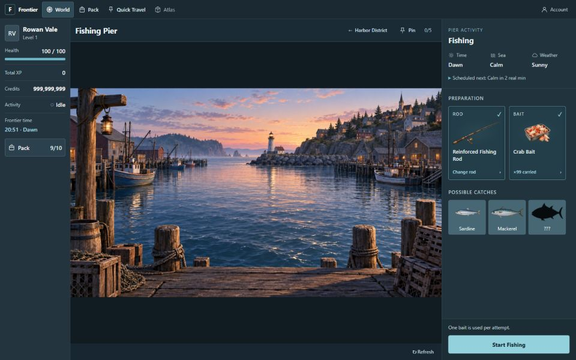

# A01 UI handoff review

Implemented 24 September 2026. Candidate: `948786be38ac291179532865437e1f6388abf68cdcce91dab52d7d275ad7d717`.
Owner appearance approval and the complete A01 MVP acceptance pass remain pending.

## What changed

- Compact navigation and character HUD, consistent Pack controls, quiet Account access, and authorized test tools inside Account.
- Location, Back and pin controls above the world. Artwork and coded overlays share one centered 16:9 contain transform.
- **Prepare tackle** opens the two equipment sockets; **Start Fishing** commits. One readiness message explains missing or unavailable supplies.
- Equipment choices use a bounded dialog on desktop and a sheet on narrow layouts, with selection marks, keyboard dismissal and focus return. Empty categories can open the existing Pack.
- One conditions row and a concise server-derived scheduled forecast; exact time is available in details. The clock remains in the HUD. Admin tools distinguish scheduled and effective phases.
- Fixed desktop action footer; narrow actions become sticky once enough of the activity panel is visible. Fishing emphasizes bait, latest catch and session results, with restrained motion and reduced-motion CSS.
- Connection loss keeps confirmed results and shows reconnection status. A confirmed server restart shows its reason separately from retained catches. Start/Stop mutations reconcile before another submission; late replies after leaving the panel cannot overwrite the character.

Gameplay rules, server schemas/APIs, balancing, clock boundaries and original artwork remain unchanged. The public API provides no attempt schedule, so the activity indicator is ambient; it promises no catch. F05 supplies no next-level XP threshold, so the HUD shows real total XP without an invented progress bar.

## Matching comparisons

These before and after captures were rendered at **1440×900 CSS pixels**. The browser capture service downsamples complete-page images (the 1440×900 captures are 960×600 JPEGs). Filenames identify the measured CSS viewport, not raster resolution. Review accounts and catches are real data from a separate disposable database; quantities and discoveries changed during verification.

| State                       | Before                                             | After                                                          |
| --------------------------- | -------------------------------------------------- | -------------------------------------------------------------- |
| Preparation                 | [Before](before-preparation-1440x900.jpg)          | [After](after-preparation-1440x900.jpg)                        |
| Picker                      | [Before](before-picker-1440x900.jpg)               | [After](after-picker-1440x900.jpg)                             |
| Ready                       | [Before](before-ready-1440x900.jpg)                | [After](after-ready-1440x900.jpg)                              |
| Active, first catch pending | [Before](before-active-1440x900.jpg)               | [After](after-active-1440x900.jpg)                             |
| Stopped/interrupted         | [Before: manual stop](before-stopped-1440x900.jpg) | [After: actual server restart](after-interrupted-1440x900.jpg) |

## Rendered acceptance sizes

| CSS viewport | Capture                                                                           | Result                                                |
| ------------ | --------------------------------------------------------------------------------- | ----------------------------------------------------- |
| 1920×1080    | [Ready](after-ready-1920x1080.jpg)                                                | No document overflow; action footer within viewport   |
| 1440×900     | [Ready](after-ready-1440x900.jpg)                                                 | No document overflow; complete 928×522 scene          |
| 1366×768     | [Ready](after-ready-1366x768.jpg)                                                 | No document overflow; footer reachable                |
| 1280×720     | [Ready](after-ready-1280x720.jpg), [Catch](after-catch-1280x720.jpg)              | Footer separate from the scrollable content           |
| 390×844      | [Full page](after-ready-390x844.jpg)                                              | One document scroll; no horizontal overflow           |
| 320×640      | [Full page](after-ready-320x640.jpg), [Equipment sheet](after-picker-320x640.jpg) | Reflow, name wrapping and action reachability checked |

Further states: [catch reward](after-catch-1440x900.jpg), [reconnecting with retained catch](after-reconnecting-1440x900.jpg), [missing bait](after-missing-bait-320x640.jpg), [Dusk/Moderate](after-dusk-moderate-1440x900.jpg), [city](after-city-1440x900.jpg).

[Layout measurements](layout-measurements.json) record the desktop geometry and narrow reflow. [Mobile action measurements](mobile-action-measurements.json) record the final conditional sticky behavior; the footer is intentionally in normal flow above the activity panel and pinned once the player scrolls into its controls.

## Checks performed

- `npm run check`: formatting, lint, typecheck, **109 tests across 14 files**, and production build passed.
- Focused tests cover duplicate Start/Stop requests, ambiguous Start reconciliation, replies after unmount, stale carried items, conditions/preview refresh, retained rewards on failures, dialog focus, and shared contain geometry.
- Live browser: entry, preparation, choices, ready, active, real catch, real no-catch, manual stop, actual restart and temporary connection loss. Bait decreased on both success and failure. No XP mutation occurred.
- Live keyboard Escape and explicit dismissal restore the originating slot. Opening Pack from missing bait preserves preparation and returns focus correctly. Native modal focus containment was used.
- Resizing preserves setup. Reviewed the longest available rod name, bait quantities through 100, and a 999,999,999-credit balance. Condition changes agree across HUD, dock and scene; Dawn/Calm and Dusk/Moderate share identical image bounds.
- Live New Harbor → Harbor → Pier and return navigation, selection before explicit entry, location pinning, Quick Travel, and the relocated authorized admin entry were exercised. Automated authorization coverage remains passing.
- Reduced motion is covered by the existing scenery tests and inspection of the new motion override. Text and silhouette contrast were checked against the chosen colors; actual screen-reader and touch hardware, a separate 200% zoom session, and a stress test of long picker lists remain for final verification.

The build reports its existing advisory about a JavaScript chunk exceeding 500 kB; the build succeeds. No new dependency was added.

No owner appearance approval is inferred from these checks. F03 approval remains intact; A01 is ready for the final test/review phase.
