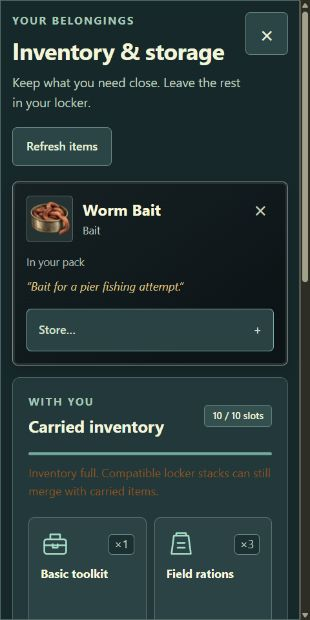
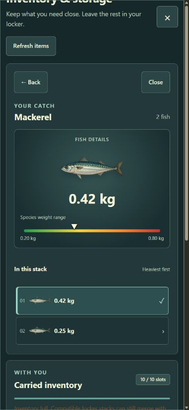

# A01 compact item cards and direct stack switching

25 September 2026. Owner visual approval and final A01 MVP verification remain pending.
Candidate source fingerprint is recorded in [revision.txt](revision.txt).

Fish stacks open their fish immediately with one click. Selecting another stack replaces the
previous collection, selects its heaviest specimen and resets list scroll. Selecting a non-fish
item replaces the collection with a compact item card. Storage controls reset on item changes.

Item cards use a dark framed surface, small icon, prominent name, readable category, short warm
flavor text and green real use effects. The quantity/stack-size table and long storage instructions
are removed. Store…/Take… reveal quantity controls on demand. Fish Back opens the same compact
action card; its Inspect fish button only returns from that secondary view. It is never required
when selecting a stack in the grid. No mechanics, API, schema, balance, or rarity tiers changed.

The visual hierarchy takes inspiration from WoW's compact item tooltips, including the name,
effects and flavor hierarchy visible in [item tooltip examples](https://www.curseforge.com/wow/addons/expositum/gallery).

## Verification

- `npm run check` passed: format, lint, typecheck, **134 tests**, and production build. The existing
  Vite chunk-size advisory remains nonblocking.
- Regression coverage verifies single-click fish inspection, same-species stack replacement,
  fish-to-item switching, reset storage disclosure, partial transfers, full-capacity compatible
  merges, full-HP restrictions, duplicate pending action prevention and focus return.
- Isolated browser checks verified immediate ten-fish inspection, replacement by a two-fish
  stack, reset scroll and selection, no retained old fish list, compact item view, and optional
  storage controls. The owner's inventory was not used.
- [Layout measurements](layout.json) show no horizontal document overflow at 1366×768, 1440×900,
  1920×1080, 1280×720, and 390×844. 320×640 also measured no horizontal overflow; the compact bait
  card was approximately 190px tall and all controls remained reachable.
- Desktop full-frame capture encountered browser-service clipping/tiling, so only the valid
  [desktop card crop](bandage-tooltip-1440x900-crop.jpg) is retained. Narrow captures show complete
  rendered content. Filenames identify CSS viewport size; captures may be resampled by the service.
- Dedicated screen-reader/touch hardware, zoom and the full A01 MVP sequence were not repeated.
  These checks do not provide owner visual approval.

