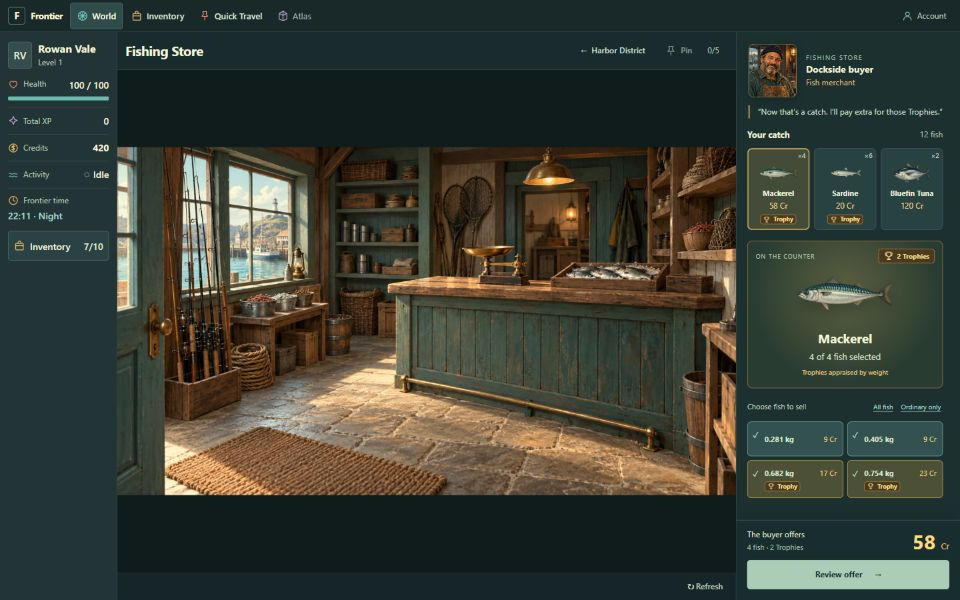
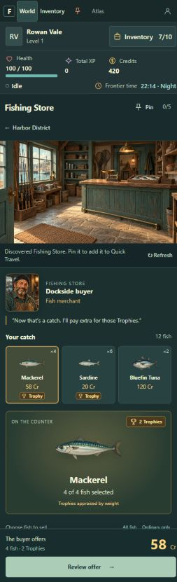

# A01 — Fishing Store interior

2026-09-25: installed the owner-supplied and approved Fishing Store image unchanged.
`src/components/locationArtwork.ts` now gives Fishing Store its own 2560×1440 scene with descriptive
alt text and no map hotspots. The existing contain transform preserves the full image; the buyer
context and Back to Harbor District remain available.

- `npm run check`: formatting, lint, typecheck, all 174 tests, and production build passed.
- Live isolated review: Back returns to the Harbor scene; selecting and entering Fishing Store
  returns to the interior and buyer. No Harbor map overlays remain inside the store.
- DOM confirmed the asset loaded at its original 2560×1440 dimensions.
- Desktop 1440×900 and narrow 390×844 CSS viewports reviewed; no horizontal overflow at narrow width.
- Existing location tests cover place artwork, resize geometry, parent navigation, and image failure.
- Owner approval covers the supplied source image; approval of this rendered integration is pending.
  A01 remains `READY_FOR_SOL_PASS_TEST` with full MVP verification pending.

Screenshot exports may be scaled by the browser capture path; CSS viewport sizes were checked from
the DOM. Both saved captures were visually inspected.

Source asset: `src/assets/locations/fishing store/fishing store.webp`.
SHA-256: `2863A53C8E2478750D7E6EF563426883B352BD4797B615988D4DBF7752B500CB`.
