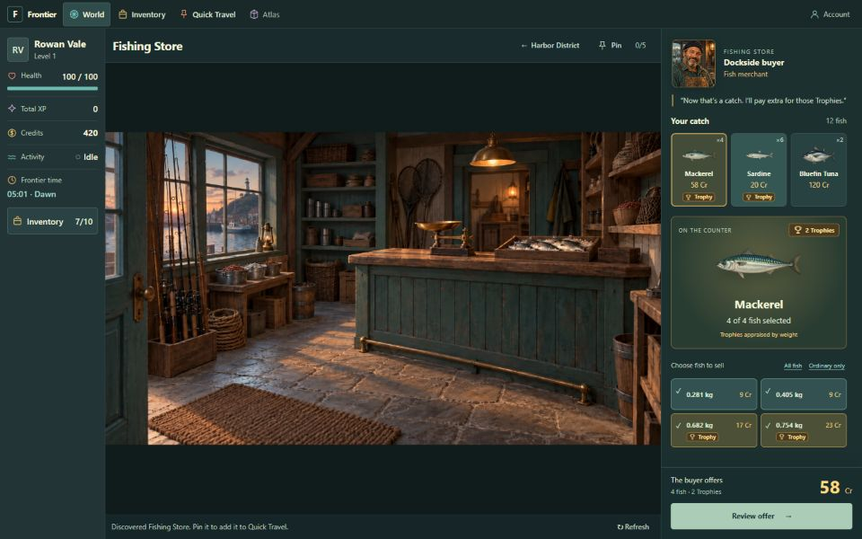
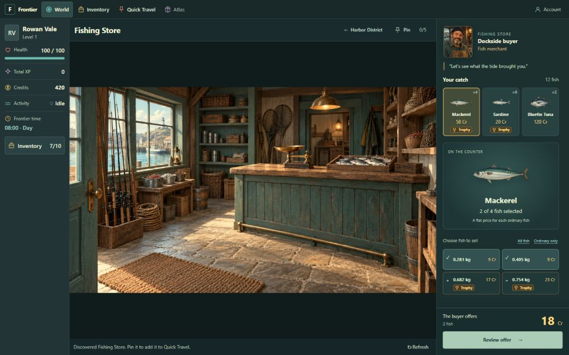
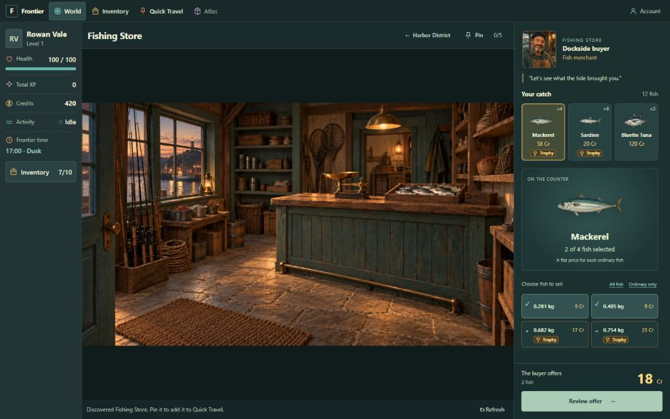
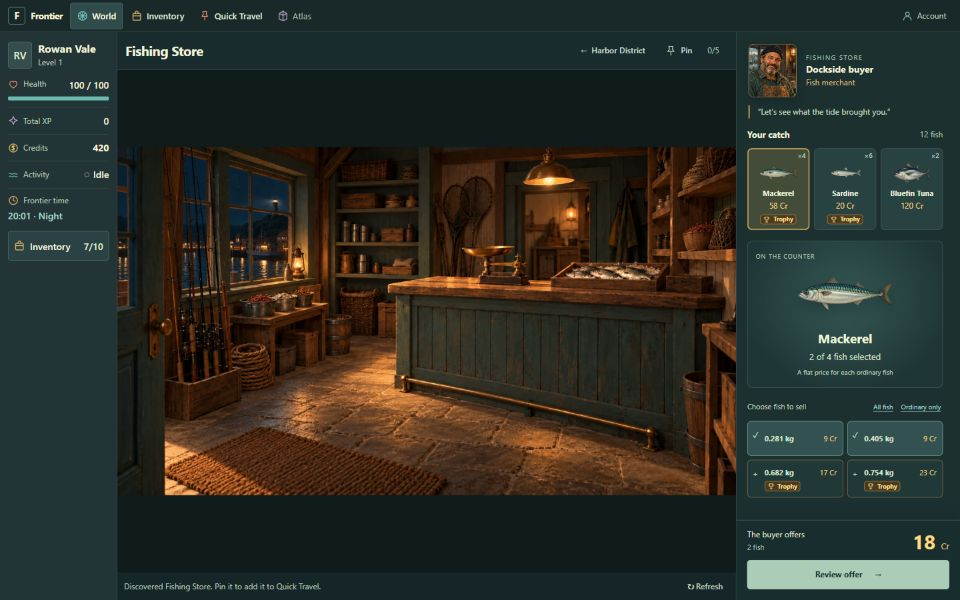

# A01 — Fishing Store time variants

2026-09-25: repaired the stale import of the removed `fishing store.webp`. The four supplied
`fishing store dawn.webp`, `fishing store day.webp`, `fishing store dusk.webp`, and
`fishing store night.webp` files now load through the existing artwork catalog.

The store uses `worldState.conditions.timeOfDay`, the same effective server phase as the HUD.
Sea state does not change the interior. Day is the fallback before the first world snapshot.
Subsequent phase changes reuse the one-second load-before-fade transition and reduced-motion
support. No new timer, gameplay rule, API, or database schema was introduced.

Verification:

- `npm run check` passed: formatting, lint, typecheck, 178 tests across 16 files, production build.
- Four new tests cover distinct phase assets, fallback, effective phase changes, sea independence,
  no inherited Harbor overlays, preserved buyer context, and crossfade behavior.
- Live browser review used the isolated buyer-review database. Shared clock overrides selected
  each phase; the HUD and loaded store image agreed for all four at 1440×900 CSS viewport size.
- After selecting Ordinary only at Dawn, the two selected Mackerel and 18 Cr offer remained
  through Day, Dusk, Night, and a return to Day. No sale was submitted.
- All images loaded at 2560×1440. The original null clock override was restored and the browser
  returned to the current scheduled Night. The viewport override was also reset.
- Saved screenshots were inspected. Their export size may differ from the measured CSS viewport.
- Source images were supplied by the owner; approval of this rendered integration remains pending.
  A01 stays `READY_FOR_SOL_PASS_TEST`, with full MVP acceptance still pending.

