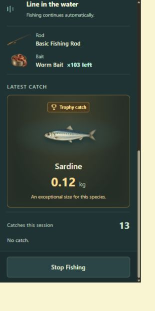
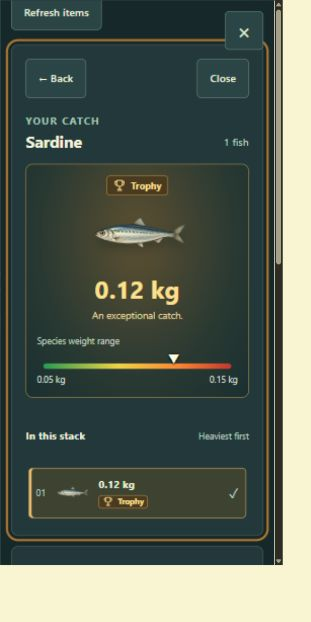

# A01 Trophy and fish collection review

25 September 2026. Candidate: `a597cc1ff620da2940f92a5977c2f25d819be0edc152ce8f6905a195345a7e79`.
Owner visual approval and the complete final A01 MVP pass remain pending.

## Changes

- Trophy catches receive the shared gold cup badge, warm illuminated card, larger weight, one brief
  light sweep, and a polite announcement. Ordinary catches keep a quieter card. Last catches remain
  visible after no-catch attempts and after stopping, including final-bait resolution.
- Fish stacks open an illustrated selected specimen with one range bar and compact, descending
  selectable fish rows. Trophy and unknown-weight states stay explicit. Back opens item actions;
  Close returns to the live inventory tile, including after manual refresh. Narrow layouts bring the
  inspector above the grid. Full ten-fish lists scroll internally.
- Inventory tiles show quantity once. Names, category information and accessible quantity labels remain.
- The only API addition is the authoritative `latestCatch.trophy` boolean, derived using the existing
  server classifier. No mechanics, balance, schema, reward, artwork, or progression changed.

## Evidence

`npm run check` passed: Prettier, ESLint, TypeScript, **132 tests in 14 files**, and production build.
The existing Vite large-chunk advisory remains nonblocking. New focused checks cover server Trophy
classification and persistence, UI Trophy/ordinary handling, stopped and no-catch retention, single
quantities, stable specimen selection, unknown weights, and focus return after manual refresh.

Live browser review used a separate local database and review character, real API-created catches,
and the existing authorized forced-Trophy path. Confirmed full-stack selection with keyboard,
ordinary/Trophy presentation, continued Fishing while inspecting inventory, manual Stop with retained
Trophy card, and narrow Stop reachability. The owner's gameplay inventory was not used.

These are measured **CSS viewport** sizes. The browser screenshot service resamples captures and
may include a padded surround; screenshots are review evidence, not source artwork.

| CSS viewport | Capture                                                                                                                               | Result                                                        |
| ------------ | ------------------------------------------------------------------------------------------------------------------------------------- | ------------------------------------------------------------- |
| 1920×1080    | [Trophy](catch-1920x1080.jpg)                                                                                                         | No document overflow; Stop within viewport                    |
| 1440×900     | [Trophy](catch-1440x900.jpg), [Trophy collection](inventory-trophy-1440x900.jpg), [Ten-fish stack](inventory-full-stack-1440x900.jpg) | Desktop composition and internal list scroll checked          |
| 1366×768     | [Trophy](catch-1366x768.jpg)                                                                                                          | No document overflow; context scrolls above fixed Stop        |
| 1280×720     | [Trophy](catch-1280x720.jpg)                                                                                                          | No document overflow; Stop reachable independently of content |
| 390×844      | [Ordinary catch](catch-390x844.jpg)                                                                                                   | No horizontal overflow; one main vertical scroll              |
| 320×640      | [Trophy](catch-320x640.jpg), [Collection](inventory-320x640.jpg)                                                                      | No horizontal overflow; collection and Stop reachable         |

Reduced-motion behavior was checked in source; dedicated screen-reader, touch hardware, 200% zoom,
and the complete A01 acceptance sequence were not certified in this scoped pass. Automated checks
and agent browser review do not constitute owner appearance approval. F00–F03 retain their passed status.
