# A01 Fishing UI review — 2026-09-23

Owner visual approval: **PENDING**. Stage: **READY_FOR_SOL_PASS_TEST**.
These are rendered browser captures of the real local Fishing flow. Capture names specify CSS-pixel
viewport dimensions; the narrow views are scrolled inside the context panel to expose controls.
The first three captures show the current candidate after owner feedback. Earlier captures below
record the initial A01 UI handoff and are superseded where styling differs.

## Corrected Fishing controls — 1440×900

Hovered Rod stays dark, and disabled Start has legible slate styling.

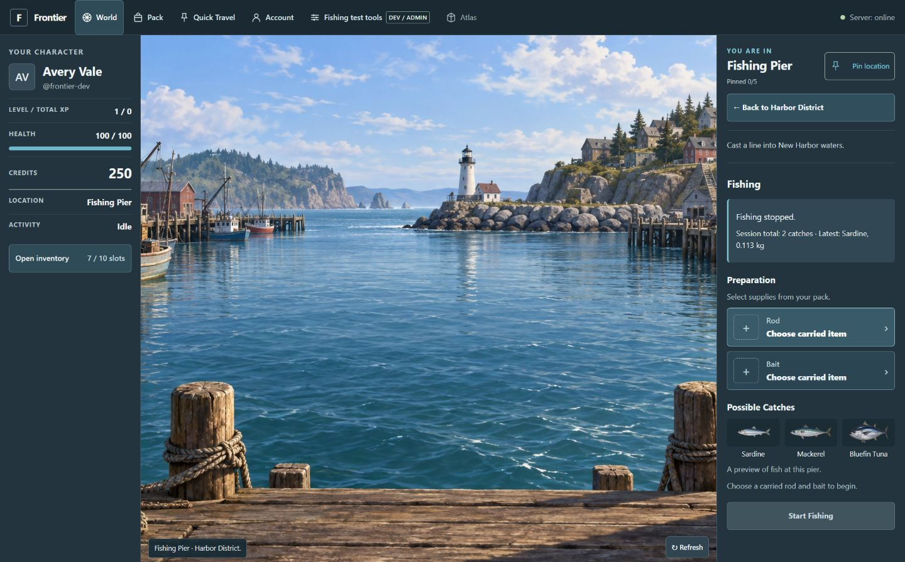

## Corrected inventory slots — 320×640

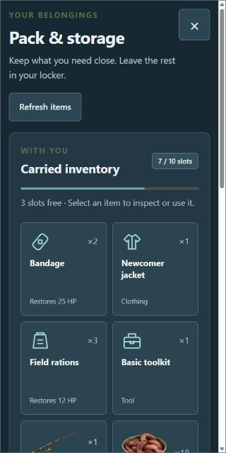

## Corrected rod, bait, and fish slots — 600×450

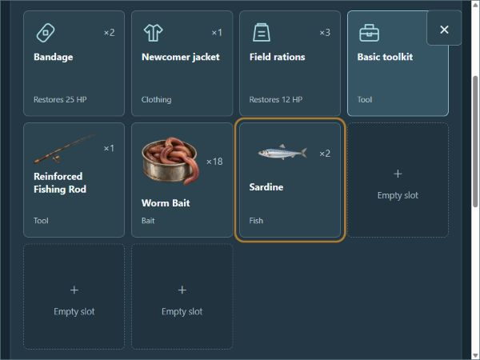

## Pinned-only Quick Travel — 1440×900

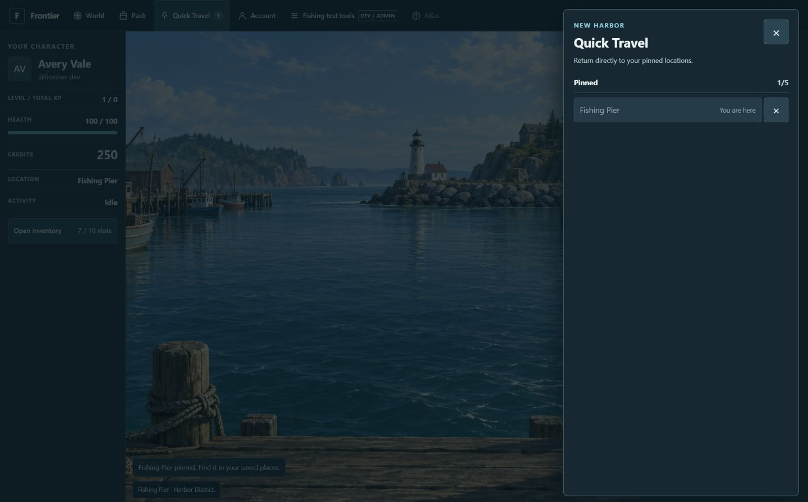

## Earlier A01 UI handoff captures

## Preparation — 1366×768

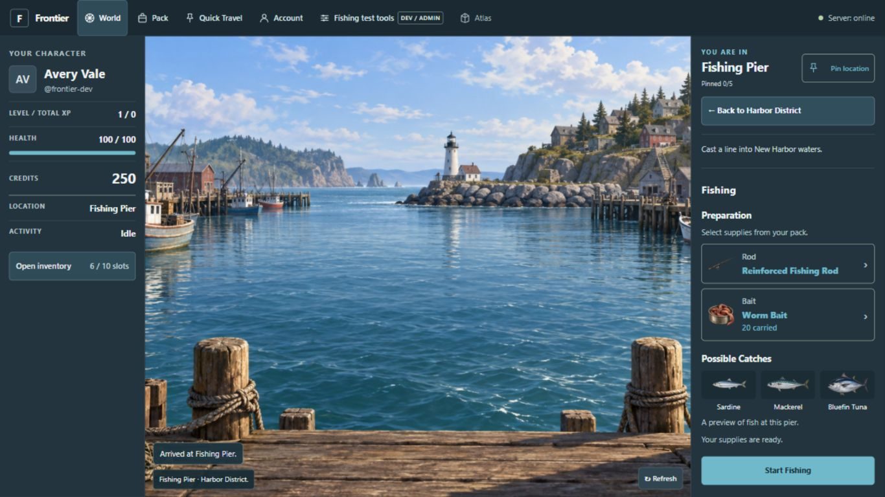

## Active — 1366×768

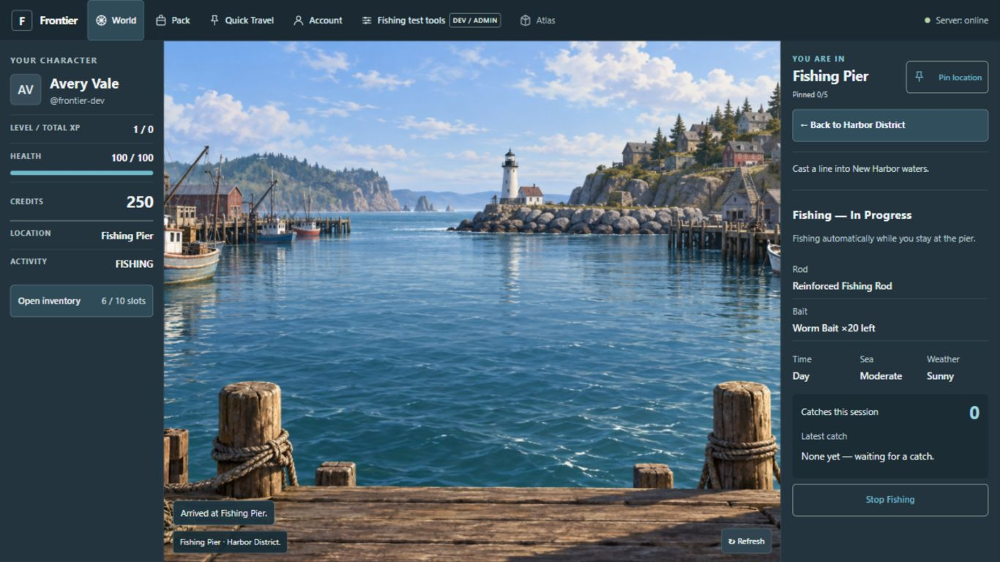

## Catch feedback — 1440×900

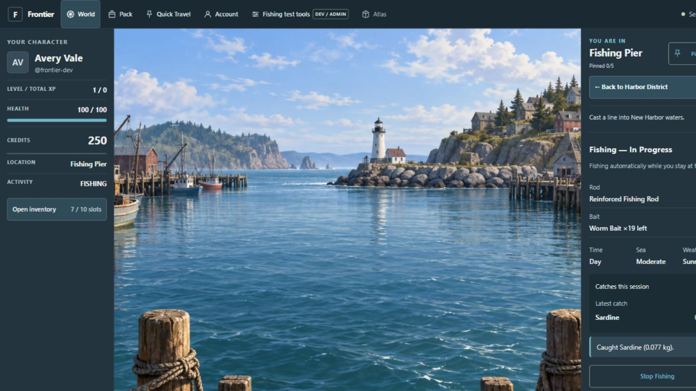

## Active — 1920×1080

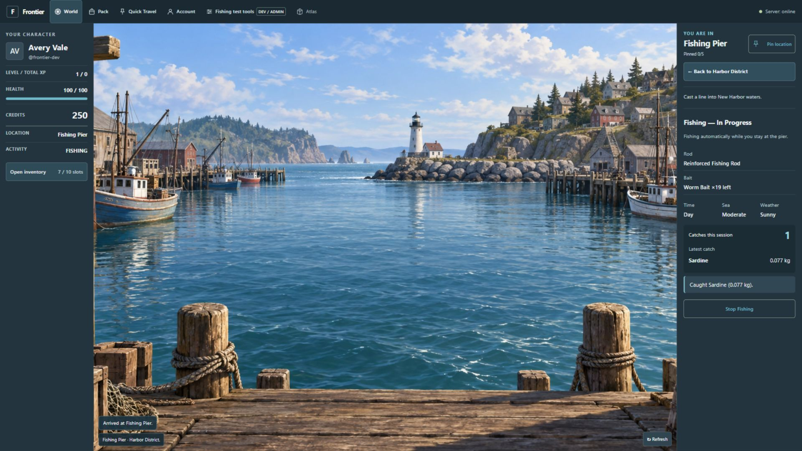

## Narrow controls — 320×640

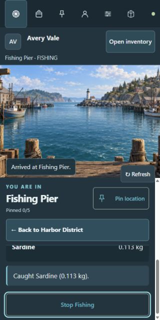

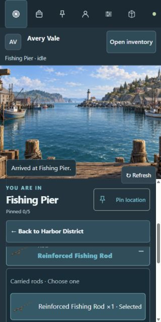

## Stopped session and preparation — 1440×900

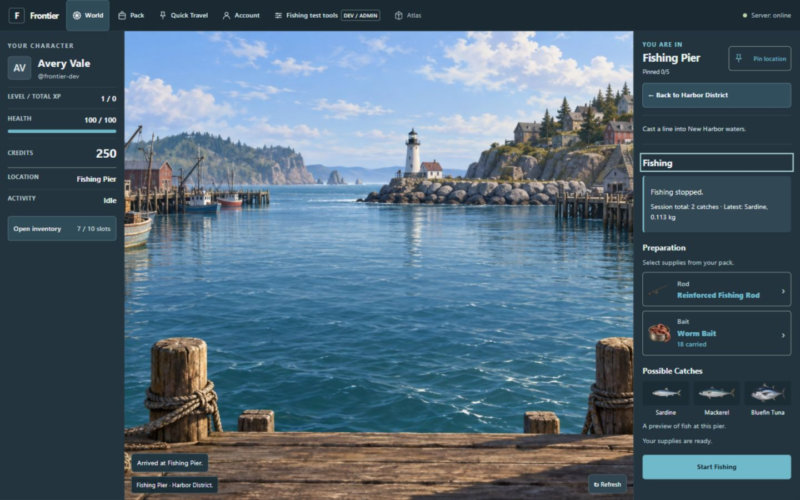

Validation: `npm run check` passed with 81 tests. Browser review covered empty and selected equipment,
keyboard focus/Escape, start, catches, real admin-supplied inventory, drawer dismissal, explicit stop,
and all four viewport sizes. Automated tests additionally cover stale inventory and request recovery.
Final MVP verification and owner approval remain separate pending gates in
[PROJECT_STATE.md](../../docs/PROJECT_STATE.md).
